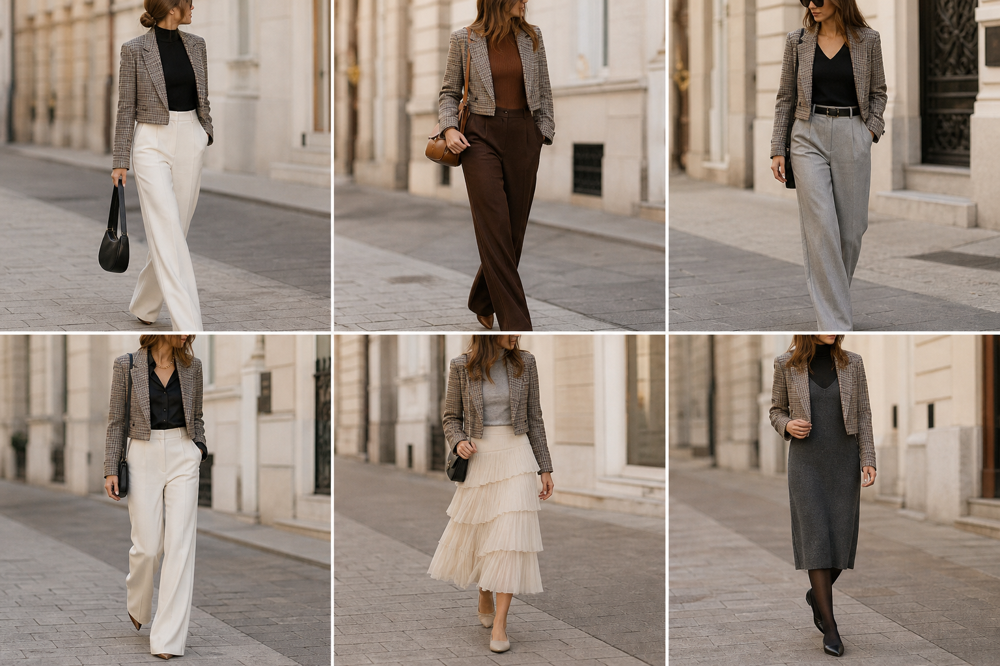

# Blazer curto xadrez — street style

Peça âncora: **BLA-09**, com as peças dela. Gerada pela API. Obs.: o xadrez saiu mais marrom/acinzentado que o real.

| # | Look | Combinação | ⭐ |
|---|---|---|---|
| 1 | Xadrez curto e off-white | BLU-23, CAL-03, Bolsa preta | |
| 2 | Xadrez curto e marrom | BLU-15, CAL-05, Bolsa caramelo | |
| 3 | Xadrez curto e cinza | BLU-22, CAL-04, ACE-02 | |
| 4 | Xadrez curto e acetinada | CAM-05, CAL-03, Colar dourado | |
| 5 | Xadrez curto e saia creme | BLU-18, SAI-01, Bolsa preta pequena | |
| 6 | Xadrez curto e vestido de lã | VES-01, Meia-calça preta fina | |
