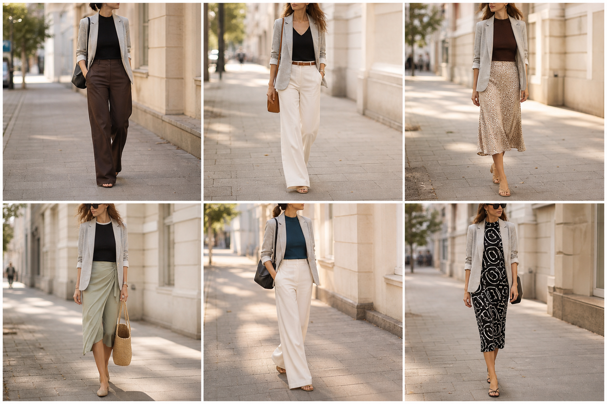

# Blazer de malha cinza (Zara) — street style

Peça âncora: **BLA-07**, com as peças dela. Gerada pela API. O look 6 (vestido letreiro) saiu com estampa errada e ficou fora do app.

| # | Look | Combinação | ⭐ |
|---|---|---|---|
| 1 | Blazer cinza e marrom | BLU-23, CAL-05, Bolsa preta | |
| 2 | Blazer cinza e off-white | BLU-22, CAL-03, ACE-01, Bolsa caramelo | |
| 3 | Blazer cinza e slip | BLU-15, SAI-02, ACE-03 | |
| 4 | Blazer cinza e saia verde | BLU-17, SAI-03, Bolsa de palha | |
| 5 | Blazer cinza e azul petróleo | BLU-19, CAL-03, Bolsa preta | |
