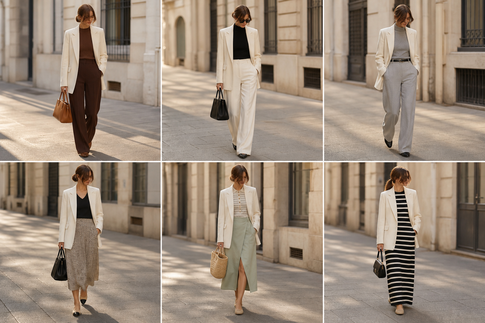

# Blazer off-white (Amaro) — street style

Peça âncora: **BLA-08**, com as peças dela. Gerada pela API.

| # | Look | Combinação | ⭐ |
|---|---|---|---|
| 1 | Blazer off-white e marrom | BLU-15, CAL-05, Bolsa caramelo | |
| 2 | Blazer off-white e calça off-white | BLU-23, CAL-03, Bolsa preta estruturada | |
| 3 | Blazer off-white e cinza | BLU-18, CAL-04, ACE-02 | |
| 4 | Blazer off-white e slip | BLU-22, SAI-02, ACE-03, Bolsa preta | |
| 5 | Blazer off-white e saia verde | BLU-11, SAI-03, Bolsa de palha | |
| 6 | Blazer off-white e vestido listrado | VES-05, Bolsa preta pequena | |
