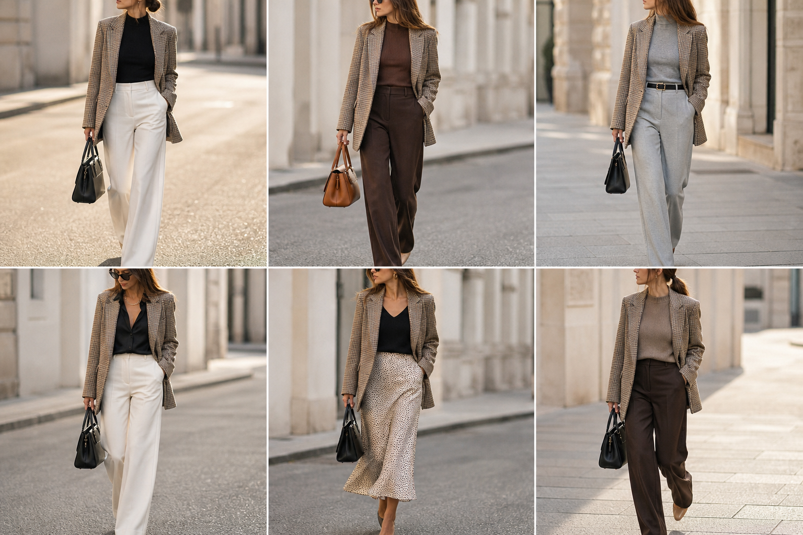

# Blazer longo pied-de-poule — street style

Peça âncora: **BLA-06**, com as peças dela. Gerada pela API.

| # | Look | Combinação | ⭐ |
|---|---|---|---|
| 1 | Pied-de-poule e off-white | BLU-23, CAL-03, Bolsa preta estruturada | |
| 2 | Pied-de-poule e marrom | BLU-15, CAL-05, Bolsa caramelo | |
| 3 | Pied-de-poule e cinza | BLU-18, CAL-04, ACE-02, Bolsa preta | |
| 4 | Pied-de-poule e acetinada | CAM-05, CAL-03, Colar dourado, Bolsa preta | |
| 5 | Pied-de-poule e slip | BLU-22, SAI-02, ACE-03, Bolsa preta | |
| 6 | Pied-de-poule e suéter | SUE-01, CAL-05, Bolsa preta | |
