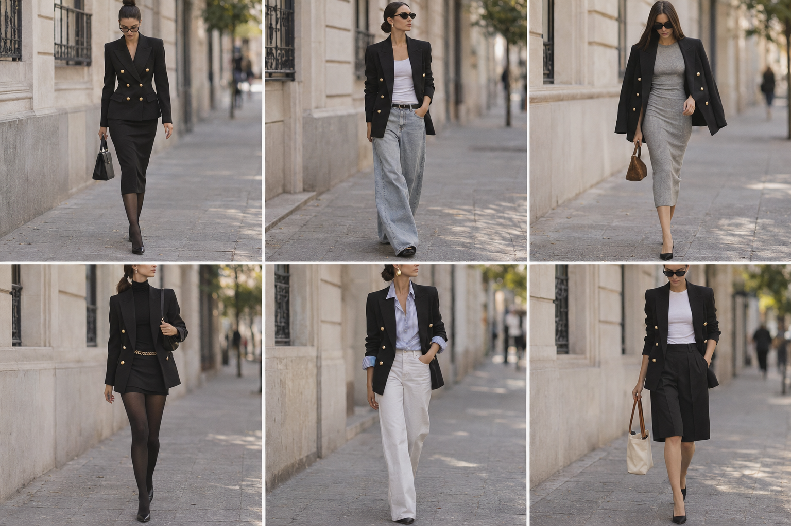

# Blazer preto trespassado (Zara) — street style

Peça âncora: **BLA-05**. Só o blazer é do acervo; o resto segue o estilo Kendall/Hailey.
Prompt: [blazer street style v2](../../prompts/2026-11-07-blazer-preto-trespassado-street-style.md).

| # | Look | Combinação (além do blazer) | ⭐ |
|---|---|---|---|
| 1 | Office siren | Blazer abotoado + saia lápis preta + meia-calça fina + óculos de grau + bolsa preta estruturada | |
| 2 | Baggy jeans | Regata branca canelada + jeans largo claro arrastando + cinto preto | |
| 3 | Nos ombros | Vestido midi de malha canelada cinza-claro + blazer nos ombros + mini bolsa de camurça | |
| 4 | Total black | Gola alta preta + minissaia preta + meia-calça opaca + cinto de corrente dourado | |
| 5 | Camisa listrada | Camisa listrada azul e branca + jeans branco reto + brincos gota dourados | |
| 6 | Bermuda de sexta | Camiseta branca + bermuda de alfaiataria preta + bolsa de lona creme | |

Observação: o cabelo saiu escuro (quase preto) em vez de castanho acobreado. Próximos prompts
reforçam a cor do cabelo.
