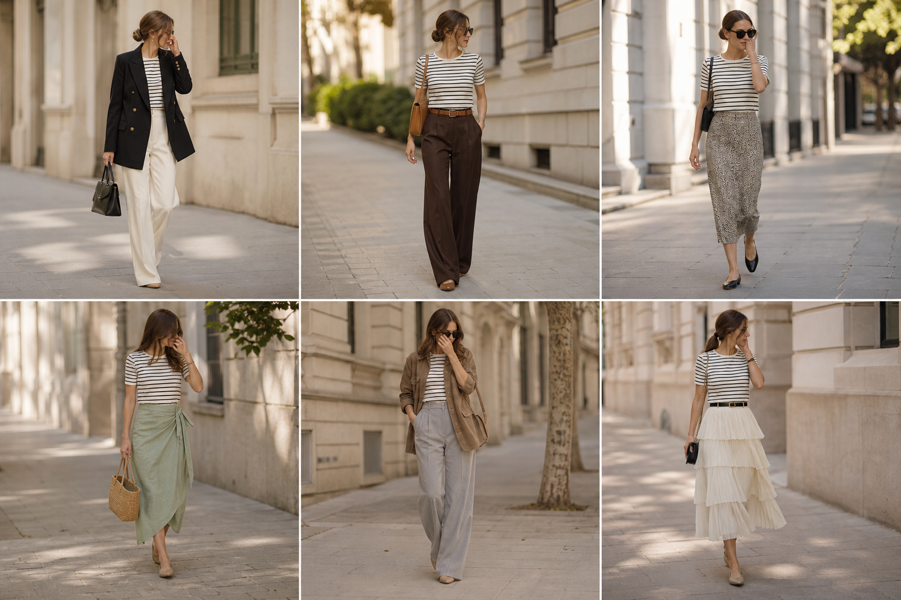

# Blusa listrada preta e branca (Emme) — street style

Peça âncora: **BLU-26**, com as peças dela. Gerada pela API.

| # | Look | Combinação | ⭐ |
|---|---|---|---|
| 1 | Listrada P&B e blazer | BLA-05, CAL-03, Bolsa preta estruturada | |
| 2 | Listrada P&B e marrom | CAL-05, ACE-01, Bolsa caramelo | |
| 3 | Listrada P&B e slip | SAI-02, Bolsa preta | |
| 4 | Listrada P&B e saia verde | SAI-03, Bolsa de palha | |
| 5 | Listrada P&B e camurça | JAQ-03, CAL-04 | |
| 6 | Listrada P&B e saia creme | SAI-01, ACE-02, Bolsa preta pequena | |
