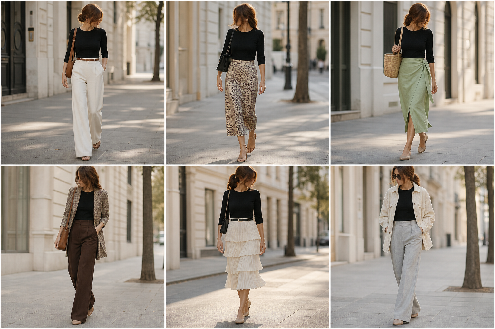

# Blusa de tricô raglã preta (Vista-me) — street style

Peça âncora: **BLU-29**, com as peças dela. Gerada pela API.

| # | Look | Combinação | ⭐ |
|---|---|---|---|
| 1 | Raglã preta e off-white | CAL-03, ACE-01, Bolsa caramelo | |
| 2 | Raglã preta e slip | SAI-02, ACE-03, Bolsa preta | |
| 3 | Raglã preta e saia verde | SAI-03, Bolsa de palha | |
| 4 | Raglã preta e pied-de-poule | BLA-06, CAL-05, Bolsa caramelo | |
| 5 | Raglã preta e saia creme | SAI-01, ACE-02, Bolsa preta pequena | |
| 6 | Raglã preta e cotelê | JAQ-06, CAL-04 | |
