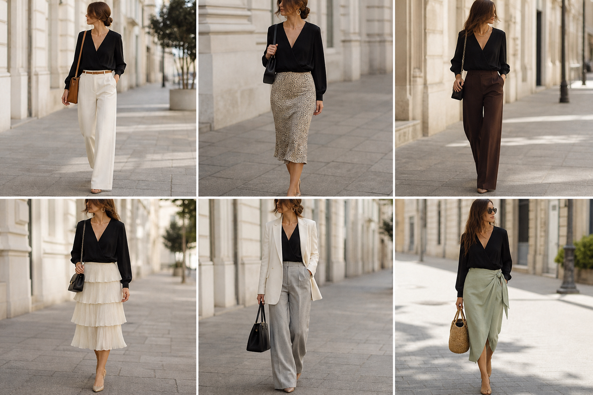

# Blusa transpassada preta (Emme) — street style

Peça âncora: **BLU-30**, com as peças dela. Gerada pela API.

| # | Look | Combinação | ⭐ |
|---|---|---|---|
| 1 | Transpassada e off-white | CAL-03, ACE-01, Bolsa caramelo | |
| 2 | Transpassada e slip | SAI-02, ACE-03, Bolsa preta | |
| 3 | Transpassada e marrom | CAL-05, Colar dourado, Bolsa preta pequena | |
| 4 | Transpassada e saia creme | SAI-01, ACE-03, Bolsa preta pequena | |
| 5 | Transpassada e blazer off-white | BLA-08, CAL-04, Bolsa preta estruturada | |
| 6 | Transpassada e saia verde | SAI-03, Bolsa de palha | |
