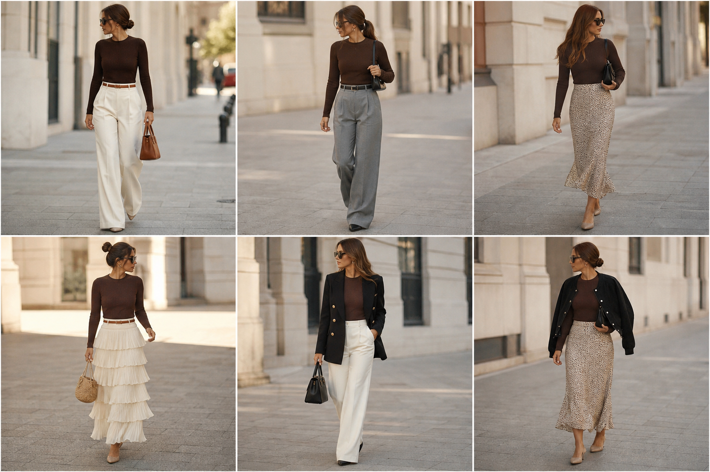

# Blusa slim de tricô marrom (Hering) — street style

Peça âncora: **BLU-15**, com as peças dela. Gerada pela API.
Prompt: [prompt](../../prompts/2026-11-07-blusa-trico-marrom-street-style.md).

| # | Look | Combinação | ⭐ |
|---|---|---|---|
| 1 | Marrom e off-white | CAL-03, ACE-01, Bolsa caramelo | |
| 2 | Marrom e cinza | CAL-04, ACE-02, Bolsa preta pequena | |
| 3 | Marrom e slip | SAI-02, Bolsa preta | |
| 4 | Marrom e saia creme | SAI-01, ACE-01, Bolsa de palha | |
| 5 | Marrom, off-white e blazer | CAL-03, BLA-05, Bolsa preta estruturada | |
| 6 | Marrom, slip e bomber | SAI-02, JAQ-02, Bolsa preta | |
