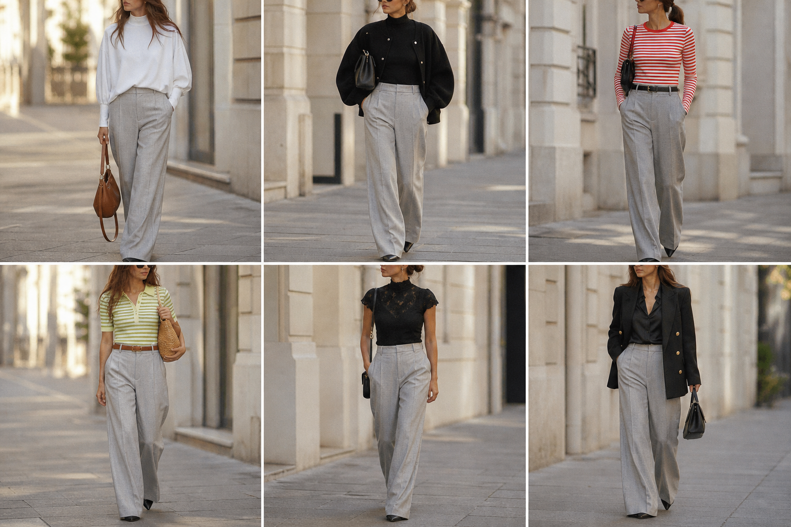

# Calça de alfaiataria cinza mescla (H&M) — street style

Peça âncora: **CAL-04**, com as peças dela. Gerada pela API (gpt-image-2).
Prompt: [prompt](../../prompts/2026-11-07-calca-cinza-hm-street-style.md).

| # | Look | Combinação | ⭐ |
|---|---|---|---|
| 1 | Cinza e Wingsuit | BLU-14, Bolsa caramelo | |
| 2 | Cinza e bomber | JAQ-02, Gola alta preta, Bolsa preta | |
| 3 | Cinza e listrada | BLU-10, ACE-02, Bolsa preta | |
| 4 | Cinza e pistache | BLU-11, ACE-01, Bolsa de palha | |
| 5 | Cinza e renda | BLU-13, ACE-03, Bolsa preta pequena | |
| 6 | Cinza, blazer e acetinada | BLA-05, CAM-05, Bolsa preta estruturada | |

O look4 foi tirado do app: a polo saiu verde, diferente da polo real.
