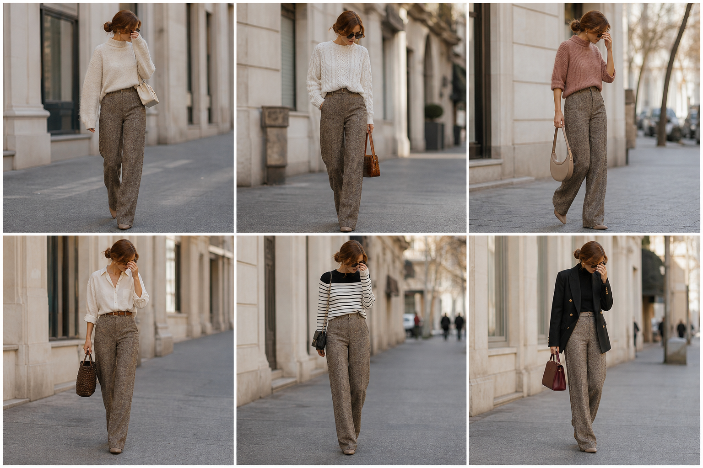

# Calça espinha de peixe marrom — street style

Peça âncora: **CAL-08**, com as peças e bolsas dela. Gerada pela API.

| # | Look | Combinação | ⭐ |
|---|---|---|---|
| 1 | Espinha e suéter creme | SUE-03, BOL-05 | |
| 2 | Espinha e tranças | SUE-08, BOL-02 | |
| 3 | Espinha e rosa queimado | SUE-11, BOL-08 | |
| 4 | Espinha e camisa branca | CAM-10, ACE-01, BOL-07 | |
| 5 | Espinha e listras | SUE-10, BOL-06 | |
| 6 | Espinha e blazer preto | BLU-33, BLA-05, BOL-01 | |
