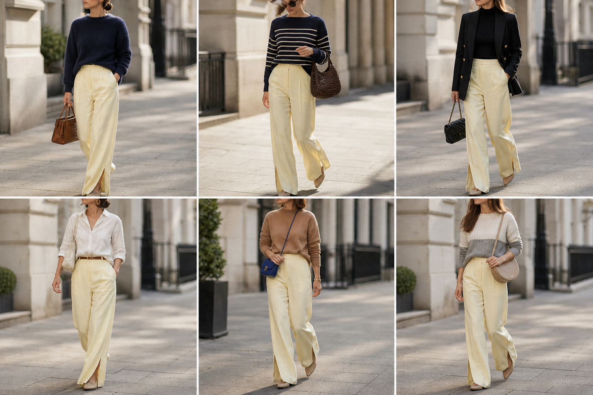

# Calça de linho amarelo-manteiga com fenda — street style

Peça âncora: **CAL-16**, com as peças e bolsas dela. Gerada pela API.

| # | Look | Combinação | ⭐ |
|---|---|---|---|
| 1 | Manteiga e marinho | SUE-02, BOL-02 | |
| 2 | Manteiga e listras marinho | SUE-07, BOL-07 | |
| 3 | Manteiga e blazer preto | BLU-33, BLA-05, BOL-06 | |
| 4 | Manteiga e camisa branca | CAM-10, ACE-01, BOL-05 | |
| 5 | Manteiga e camelo | SUE-12, BOL-03 | |
| 6 | Manteiga e color block | SUE-13, BOL-08 | |
