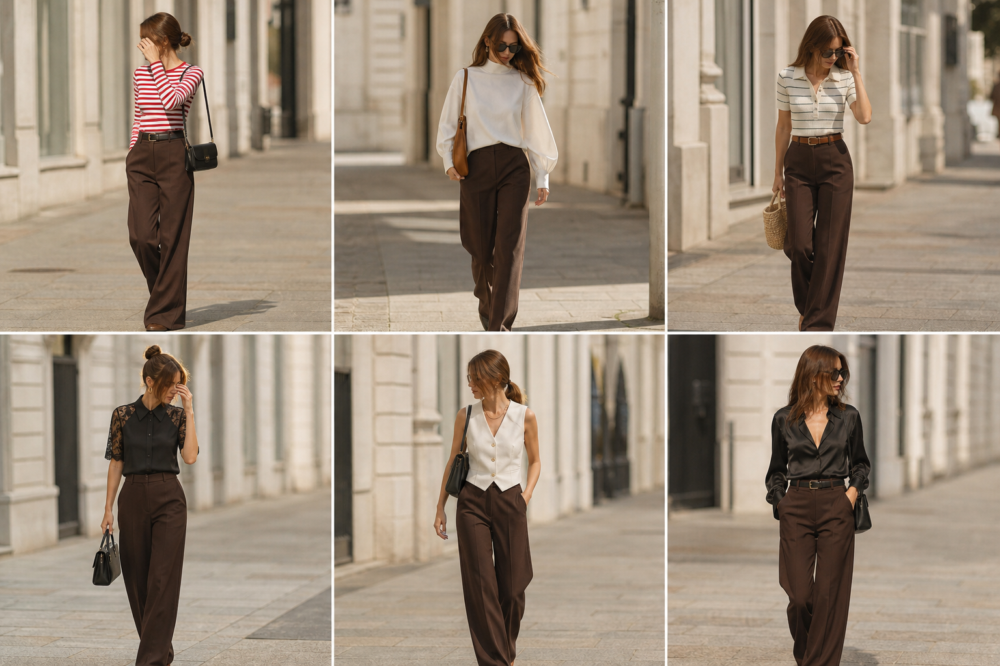

# Calça de alfaiataria marrom escuro — street style

Peça âncora: **CAL-05**, com as peças dela. Gerada pela API.
Prompt: [prompt](../../prompts/2026-11-07-calca-marrom-street-style.md).

| # | Look | Combinação | ⭐ |
|---|---|---|---|
| 1 | Marrom e listrada | BLU-10, ACE-02, Bolsa preta pequena | |
| 2 | Marrom e Wingsuit | BLU-14, Bolsa caramelo | |
| 3 | Marrom e polo mescla | BLU-11, ACE-01, Bolsa de palha | |
| 4 | Marrom e renda | BLU-13, ACE-03, Bolsa preta estruturada | |
| 5 | Marrom e colete creme | COL-03, Colar dourado, Bolsa preta | |
| 6 | Marrom e acetinada | CAM-05, ACE-02 | |
