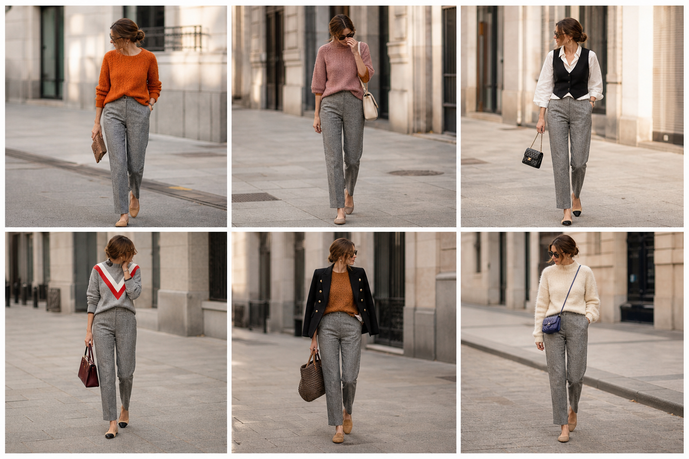

# Calça reta cinza espinha de peixe (Zara) — street style

Peça âncora: **CAL-18**, com as peças e bolsas dela. Gerada pela API.

| # | Look | Combinação | ⭐ |
|---|---|---|---|
| 1 | Cinza reta e laranja | SUE-06, BOL-02 | |
| 2 | Cinza reta e rosa | SUE-11, BOL-05 | |
| 3 | Cinza reta e colete | CAM-10, COL-02, BOL-06, ACE-03 | |
| 4 | Cinza reta e chevron | SUE-04, BOL-01 | |
| 5 | Cinza reta e blazer preto | BLU-38, BLA-05, BOL-07 | |
| 6 | Cinza reta e suéter creme | SUE-03, BOL-03 | |
