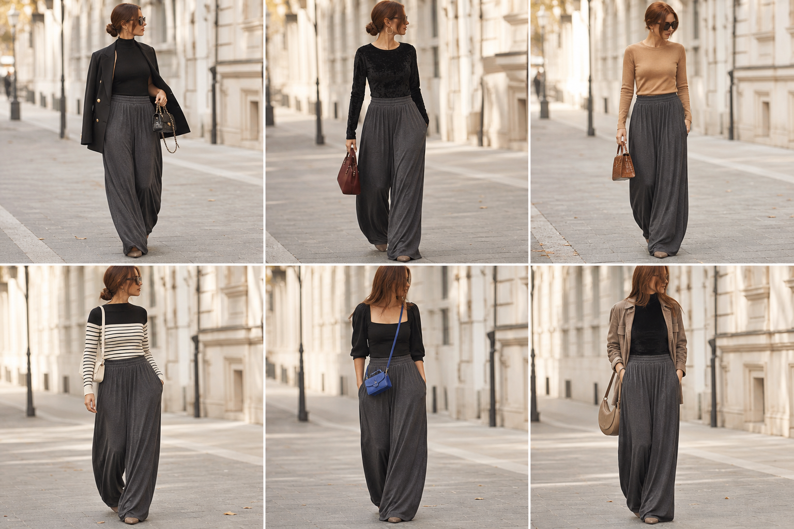

# Calça saruel fluida cinza (Zara) — street style

Peça âncora: **CAL-12**, com as peças e bolsas dela. Gerada pela API.

| # | Look | Combinação | ⭐ |
|---|---|---|---|
| 1 | Saruel e blazer preto | BLU-33, BLA-05, BOL-06 | |
| 2 | Saruel e veludo | BLU-37, BOL-01, ACE-03 | |
| 3 | Saruel e camelo | SUE-12, BOL-02 | |
| 4 | Saruel e listras | SUE-10, BOL-05 | |
| 5 | Saruel e body bufante | BLU-35, BOL-03 | |
| 6 | Saruel e camurça | BLU-36, JAQ-03, BOL-08 | |
