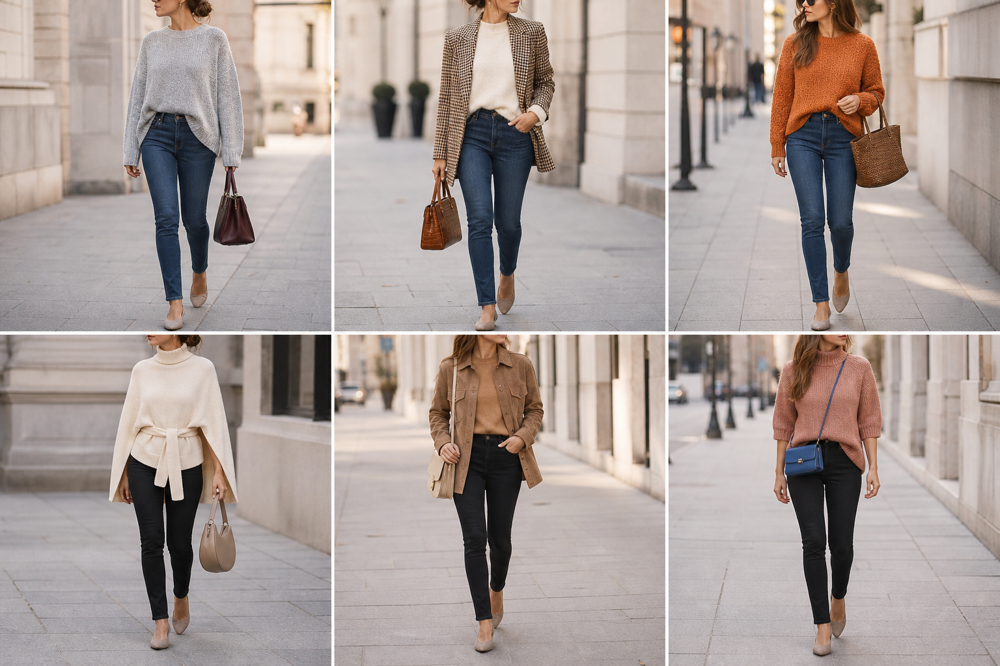

# Calças jeans azul e preta — street style

Peças âncora: **CAL-14** e **CAL-15**, com as peças e bolsas dela. Gerada pela API.

| # | Look | Combinação | ⭐ |
|---|---|---|---|
| 1 | Jeans e chenille | CAL-14, SUE-09, BOL-01 | |
| 2 | Jeans e pied-de-poule | CAL-14, SUE-03, BLA-06, BOL-02 | |
| 3 | Jeans e laranja | CAL-14, SUE-06, BOL-07 | |
| 4 | Jeans preto e capa creme | CAL-15, CAS-06, BOL-08 | |
| 5 | Jeans preto e camurça | CAL-15, SUE-12, JAQ-03, BOL-05 | |
| 6 | Jeans preto e rosa | CAL-15, SUE-11, BOL-03 | |
