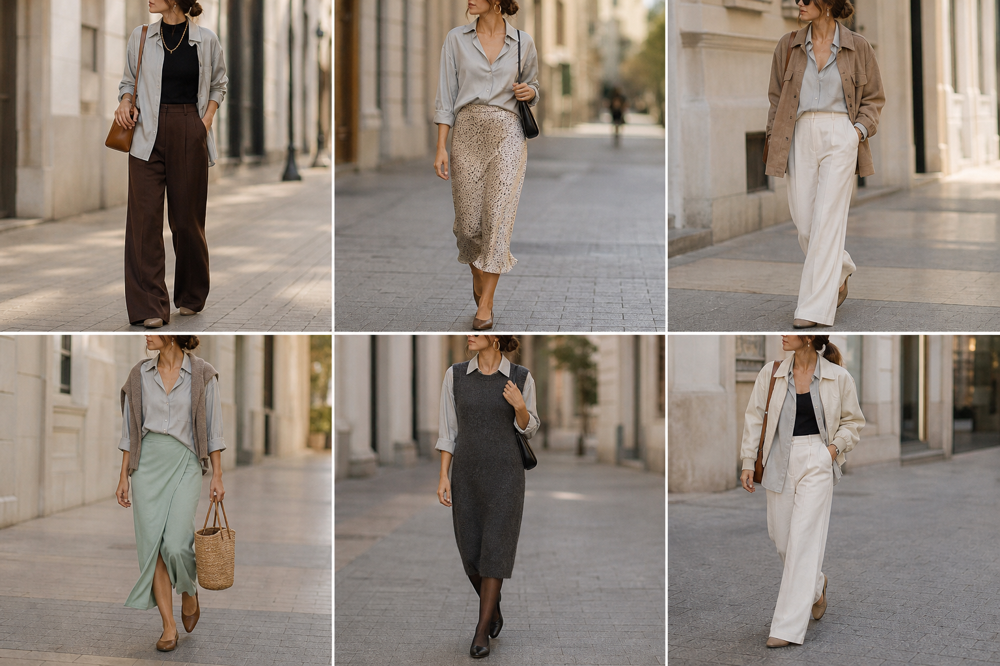

# Camisa fluida cinza (Zara) — street style

Peça âncora: **CAM-07**, com as peças dela. Gerada pela API, com truques contra o efeito uniforme.

| # | Look | Combinação | ⭐ |
|---|---|---|---|
| 1 | Cinza aberta e marrom | BLU-23, CAL-05, Colar dourado, Bolsa caramelo | |
| 2 | Cinza e slip | SAI-02, ACE-03, Bolsa preta | |
| 3 | Cinza e camurça | JAQ-03, CAL-03 | |
| 4 | Cinza e saia verde | SUE-01, SAI-03, Bolsa de palha | |
| 5 | Cinza e vestido de lã | VES-01, ACE-03, Meia-calça preta fina | |
| 6 | Cinza e bomber off-white | BLU-23, JAQ-08, CAL-03 | |
