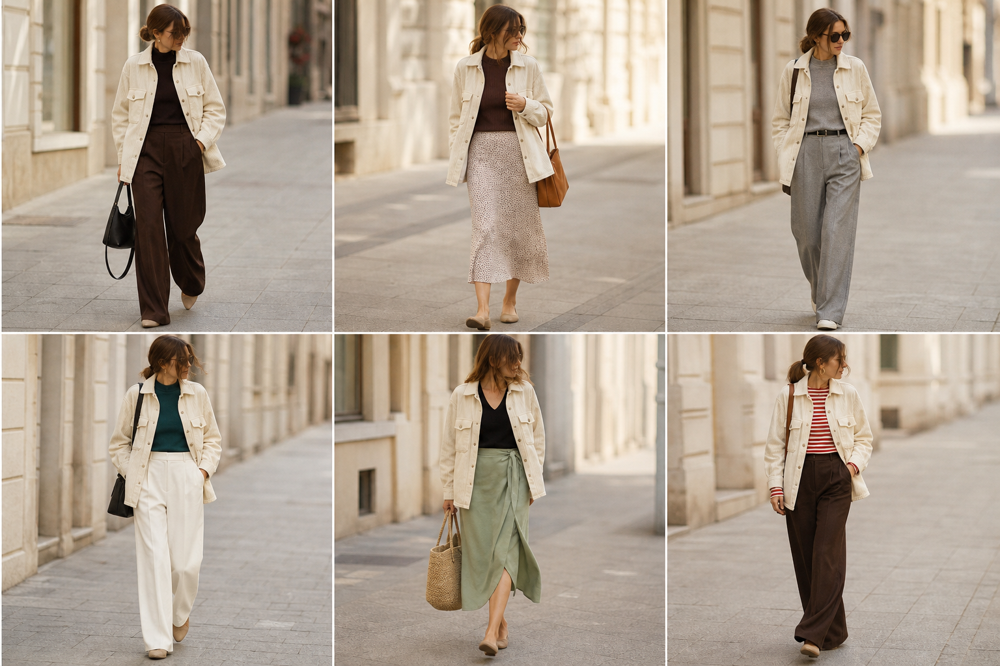

# Camisa-jaqueta de veludo cotelê off-white (Zara) — street style

Peça âncora: **JAQ-06**, com as peças dela. Gerada pela API.

| # | Look | Combinação | ⭐ |
|---|---|---|---|
| 1 | Cotelê e marrom | BLU-23, CAL-05, Bolsa preta | |
| 2 | Cotelê e slip | BLU-15, SAI-02, Bolsa caramelo | |
| 3 | Cotelê e cinza | BLU-18, CAL-04, ACE-02 | |
| 4 | Cotelê e azul petróleo | BLU-19, CAL-03, Bolsa preta | |
| 5 | Cotelê e saia verde | BLU-22, SAI-03, Bolsa de palha | |
| 6 | Cotelê e listrada | BLU-10, CAL-05, ACE-03 | |
