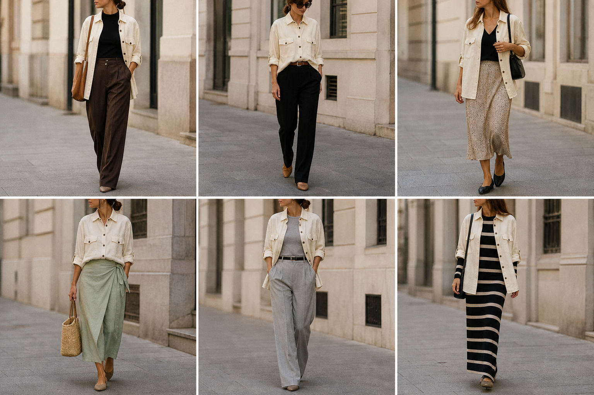

# Camisa-jaqueta utilitária off-white (Max Mara) — street style

Peça âncora: **CAM-06**, com as peças dela. Gerada pela API.

| # | Look | Combinação | ⭐ |
|---|---|---|---|
| 1 | Max Mara e marrom | BLU-23, CAL-05, Bolsa caramelo | |
| 2 | Max Mara fechada e preto | ACE-01, Calça de alfaiataria preta | |
| 3 | Max Mara e slip | BLU-22, SAI-02, Bolsa preta | |
| 4 | Max Mara e saia verde | SAI-03, ACE-03, Bolsa de palha | |
| 5 | Max Mara e cinza | BLU-18, CAL-04, ACE-02 | |
| 6 | Max Mara e vestido listrado | VES-05, Bolsa preta pequena | |

> Removidos do app: 2 (fechada e preto) e 4 (saia verde) — mostravam a camisa por dentro; ela é larga e longa demais para isso.
