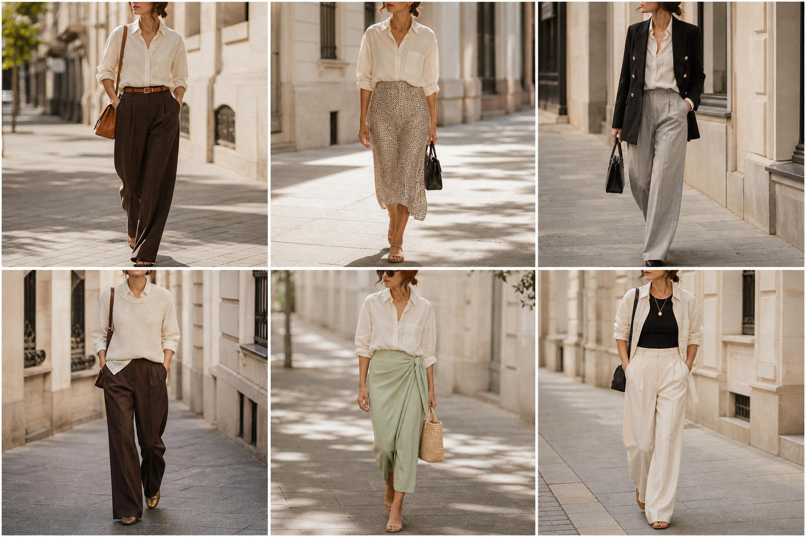

# Camisa de linho off-white (Amaro) — street style

Peça âncora: **CAM-10**, com as peças dela. Gerada pela API.

| # | Look | Combinação | ⭐ |
|---|---|---|---|
| 1 | Linho off-white e marrom | CAL-05, ACE-01, Bolsa caramelo | |
| 2 | Linho off-white e slip | SAI-02, ACE-03, Bolsa preta | |
| 3 | Linho off-white e blazer | BLA-05, CAL-04, Bolsa preta estruturada | |
| 4 | Linho off-white e colete | BLU-25, CAL-05 | |
| 5 | Linho off-white e saia verde | SAI-03, Bolsa de palha | |
| 6 | Linho off-white aberta | BLU-23, CAL-03, Colar dourado | |
