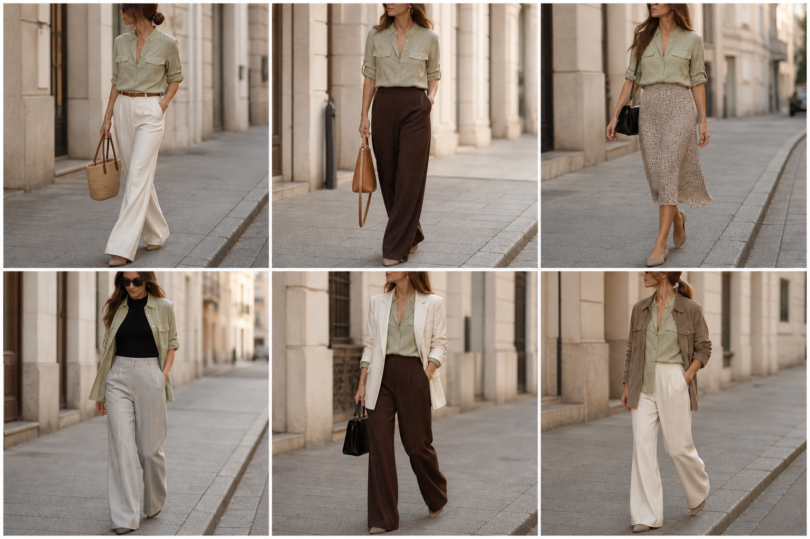

# Camisa de linho verde-sálvia (Zara) — street style

Peça âncora: **CAM-08**, com as peças dela. Gerada pela API.

| # | Look | Combinação | ⭐ |
|---|---|---|---|
| 1 | Linho e off-white | CAL-03, ACE-01, Bolsa de palha | |
| 2 | Linho e marrom | CAL-05, ACE-03, Bolsa caramelo | |
| 3 | Linho e slip | SAI-02, Bolsa preta | |
| 4 | Linho aberta e cinza | BLU-23, CAL-04 | |
| 5 | Linho e blazer off-white | BLA-08, CAL-05, Bolsa preta estruturada | |
| 6 | Linho e camurça | JAQ-03, CAL-03 | |
