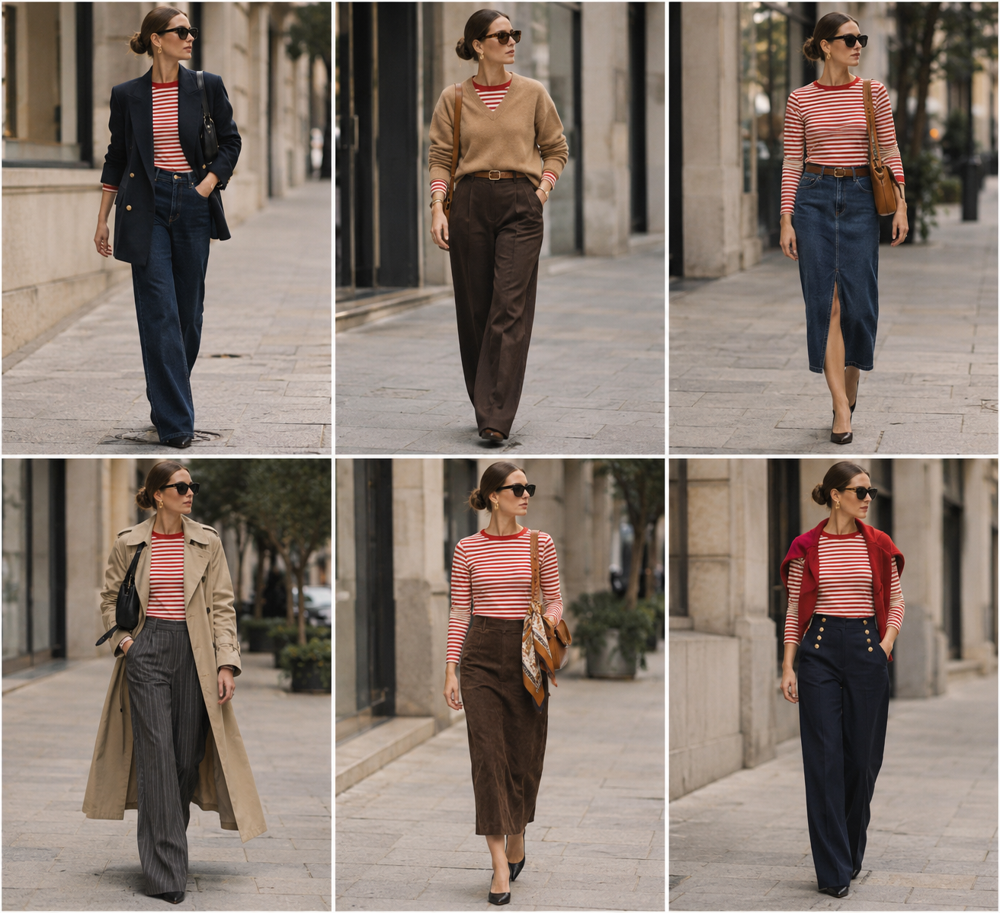

# Camiseta listrada vermelha — rodada 2 (peças variadas)

Peça âncora: **BLU-10**. Só a camiseta é do acervo; o resto é inspiração com outros tipos de peça.
Prompt: [rodada 2](../../prompts/2026-11-07-camiseta-listrada-rodada-2.md).

| # | Look | Combinação (além da camiseta) | ⭐ |
|---|---|---|---|
| 1 | Blazer marinho | Blazer marinho trespassado + jeans reto escuro + bolsa preta | |
| 2 | Suéter por cima | Suéter camelo decote V + calça de alfaiataria chocolate + cinto marrom | |
| 3 | Saia jeans | Saia midi jeans escura com fenda + cinto marrom + bolsa caramelo | |
| 4 | Trench e risca de giz | Trench bege longo + calça risca de giz cinza-chumbo + bolsa preta | |
| 5 | Camurça | Saia midi de camurça chocolate + lenço de seda na bolsa caramelo | |
| 6 | Marinheiro | Calça marinheiro azul marinho com botões dourados + cardigã vermelho nos ombros | |

Peças novas que apareceram aqui e podem virar lista de compras: blazer marinho trespassado,
suéter camelo decote V, saia midi jeans, calça risca de giz, saia midi de camurça, calça marinheiro.
