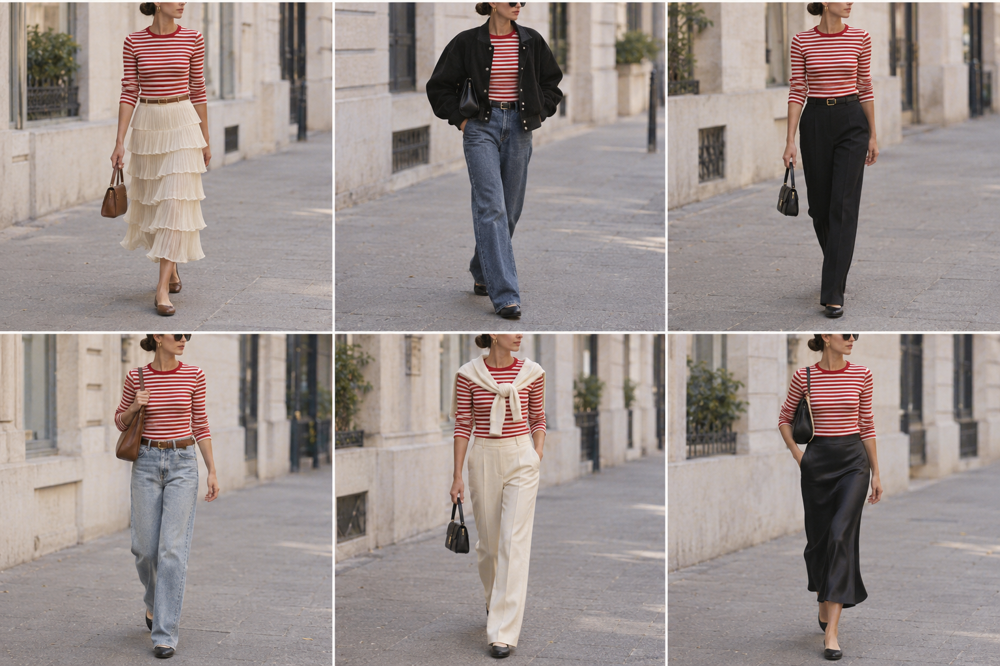

# Camiseta listrada vermelha — street style

Peça âncora: **BLU-10** (camiseta manga longa listrada vermelho e off-white).
Prompt: [camiseta listrada street style](../../prompts/2026-11-07-camiseta-listrada-vermelha-street-style.md).
Ficou boa, mas repetiu demais a saia e a jaqueta. A rodada 2 usa outros tipos de peça.

| # | Look | Combinação (além da camiseta) | ⭐ |
|---|---|---|---|
| 1 | Saia creme | SAI-01 + cinto caramelo + bolsa caramelo | |
| 2 | Com a bomber | JAQ-02 + jeans reto azul médio + cinto preto + bolsa baguete preta | |
| 3 | Alfaiataria preta | Calça de alfaiataria preta + cinto preto + bolsa preta | |
| 4 | Jeans claro | Jeans reto lavagem clara + cinto marrom + bolsa marrom | |
| 5 | Off-white | Calça de alfaiataria off-white + suéter off-white nos ombros + bolsa preta | |
| 6 | Saia de cetim | Saia midi de cetim preta + bolsa preta | |
