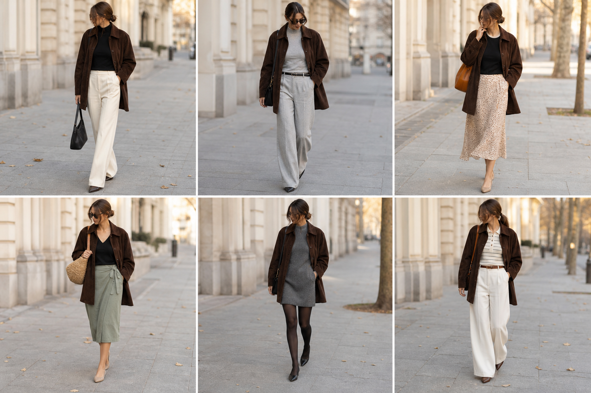

# Casaco-camisa aveludado marrom — street style

Peça âncora: **CAS-04**, com as peças dela. Gerada pela API. Obs.: no look 5 o vestido saiu mais curto que o real.

| # | Look | Combinação | ⭐ |
|---|---|---|---|
| 1 | Casaco marrom e off-white | BLU-23, CAL-03, Bolsa preta | |
| 2 | Casaco marrom e cinza | BLU-18, CAL-04, ACE-02 | |
| 3 | Casaco marrom e slip | BLU-17, SAI-02, Bolsa caramelo | |
| 4 | Casaco marrom e saia verde | BLU-22, SAI-03, Bolsa de palha | |
| 5 | Casaco marrom e vestido de lã | VES-01, BLU-18, Meia-calça preta fina | |
| 6 | Casaco marrom e polo | BLU-11, CAL-03, ACE-01 | |
