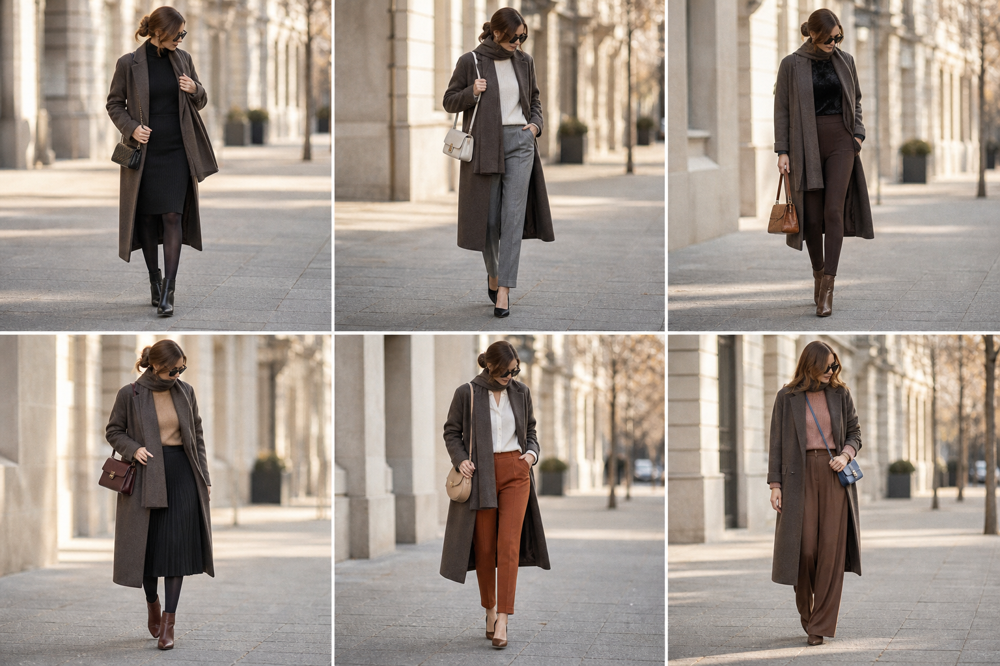

# Casaco de tricô marrom (Shoulder) — cor certa

Peça âncora: **CAS-03** (marrom acinzentado escuro). Gerada pela API.

| # | Look | Combinação |
|---|---|---|
| 1 | Casaco marrom e preto | BLU-33, SAI-05, BOL-06, Meia-calça fina preta, Bota preta |
| 2 | Casaco marrom e calça cinza | SUE-03, CAL-18, BOL-05, Sapato preto de salto bloco |
| 3 | Casaco marrom e legging | BLU-37, CAL-19, BOL-02, Bota marrom |
| 4 | Casaco marrom e plissada | SUE-12, SAI-10, BOL-01, Meia-calça fina preta, Bota marrom |
| 5 | Casaco marrom e terracota | CAM-10, CAL-13, SAP-02, BOL-08 |
| 6 | Casaco marrom e canela | SUE-11, CAL-17, BOL-03, Bota marrom |
