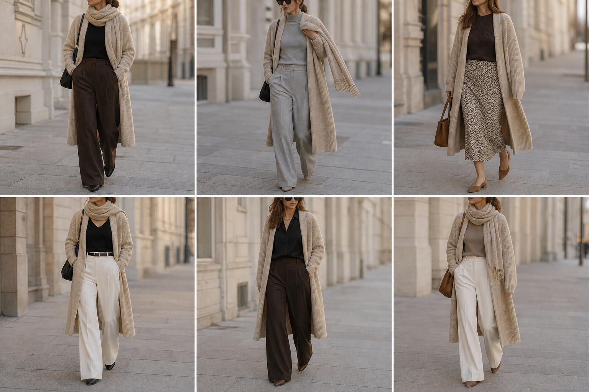

# Casaco de tricô com cachecol bege (Shoulder) — street style

Peça âncora: **CAS-03**, com as peças dela. Gerada pela API.

| # | Look | Combinação | ⭐ |
|---|---|---|---|
| 1 | Casaco tricô e marrom | BLU-23, CAL-05, Bolsa preta | |
| 2 | Casaco tricô e cinza | BLU-18, CAL-04, Bolsa preta | |
| 3 | Casaco tricô e slip | BLU-15, SAI-02, Bolsa caramelo | |
| 4 | Casaco tricô e off-white | BLU-22, CAL-03, ACE-02, Bolsa preta | |
| 5 | Casaco tricô e acetinada | CAM-05, CAL-05, Colar dourado | |
| 6 | Casaco tricô e suéter taupe | SUE-01, CAL-03, Bolsa caramelo | |

> Removidos do app: c27-01..06 (o casaco saiu bege; o real é marrom acinzentado escuro).
