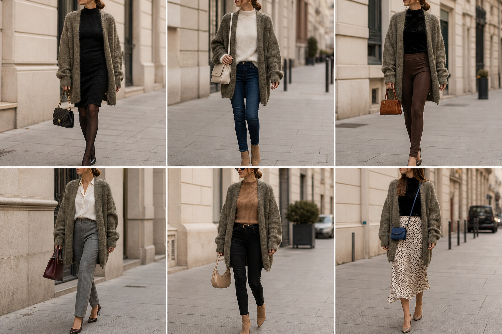

# Casaco de tricô grosso oversized — street style

Peça âncora: **CAS-08**, com as peças e bolsas dela. Gerada pela API.

| # | Look | Combinação | ⭐ |
|---|---|---|---|
| 1 | Tricô oliva e preto | BLU-33, SAI-05, BOL-06, Meia-calça fina preta | |
| 2 | Tricô oliva e jeans | SUE-03, CAL-14, BOL-05 | |
| 3 | Tricô oliva e legging | BLU-37, CAL-19, BOL-02 | |
| 4 | Tricô oliva e calça cinza | CAM-10, CAL-18, BOL-01, ACE-03 | |
| 5 | Tricô oliva e jeans preto | SUE-12, CAL-15, BOL-08 | |
| 6 | Tricô oliva e slip | BLU-36, SAI-02, BOL-03 | |
