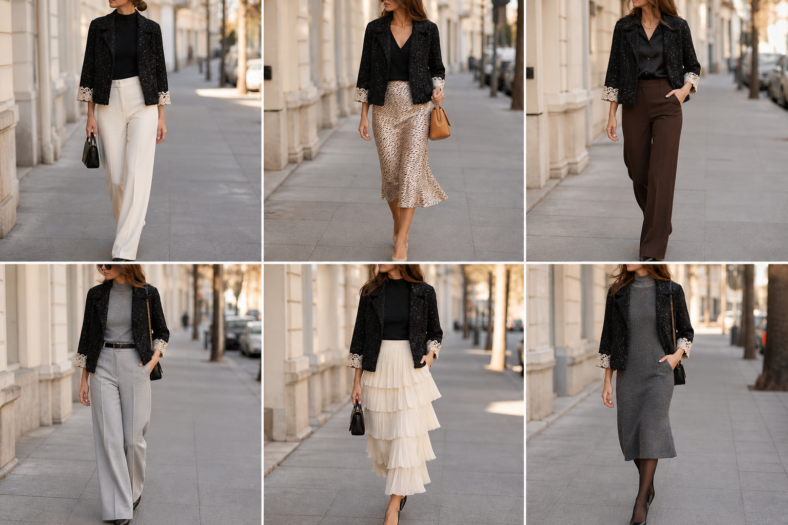

# Casaquinho de bouclé com paetês (Lemoncola) — street style

Peça âncora: **JAQ-07**, com as peças dela. Gerada pela API.

| # | Look | Combinação | ⭐ |
|---|---|---|---|
| 1 | Bouclé e off-white | BLU-23, CAL-03, Bolsa preta pequena | |
| 2 | Bouclé e slip | BLU-22, SAI-02, ACE-03, Bolsa caramelo | |
| 3 | Bouclé e marrom | CAM-05, CAL-05, Colar dourado | |
| 4 | Bouclé e cinza | BLU-18, CAL-04, ACE-02 | |
| 5 | Bouclé e saia creme | BLU-23, SAI-01, Bolsa preta pequena | |
| 6 | Bouclé e vestido de lã | VES-01, BLU-18, Meia-calça preta fina | |
