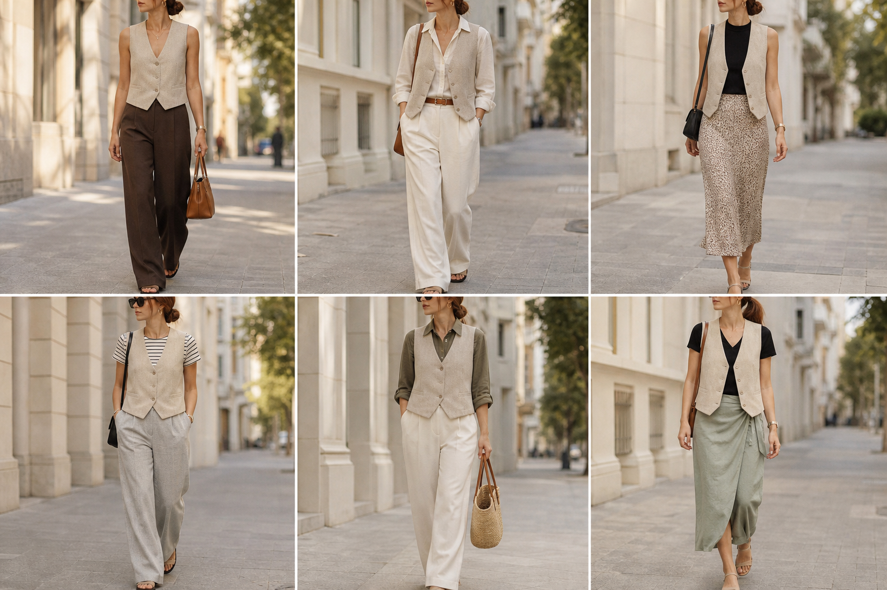

# Colete espinha de peixe bege (Emme) — street style

Peça âncora: **COL-04**, com as peças dela. Gerada pela API.

| # | Look | Combinação | ⭐ |
|---|---|---|---|
| 1 | Colete bege sozinho e marrom | CAL-05, ACE-03, Bolsa caramelo | |
| 2 | Colete bege e camisa de linho | CAM-10, CAL-03, ACE-01 | |
| 3 | Colete bege e slip | BLU-23, SAI-02, Bolsa preta | |
| 4 | Colete bege e listrada P&B | BLU-26, CAL-04 | |
| 5 | Colete bege e camisa oliva | CAM-09, CAL-03, Bolsa de palha | |
| 6 | Colete bege e saia verde | BLU-22, SAI-03 | |
