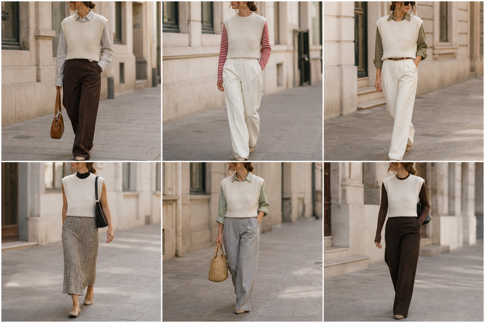

# Colete de tricô off-white — street style

Peça âncora: **BLU-25**, com as peças dela. Gerada pela API.

| # | Look | Combinação | ⭐ |
|---|---|---|---|
| 1 | Colete e camisa cinza | CAM-07, CAL-05, Bolsa caramelo | |
| 2 | Colete e listrada | BLU-10, CAL-03 | |
| 3 | Colete e camisa oliva | CAM-09, CAL-03, ACE-01 | |
| 4 | Colete e slip | BLU-23, SAI-02, Bolsa preta | |
| 5 | Colete e camisa sálvia | CAM-08, CAL-04, Bolsa de palha | |
| 6 | Colete e tricô marrom | BLU-15, CAL-05, Bolsa preta | |
