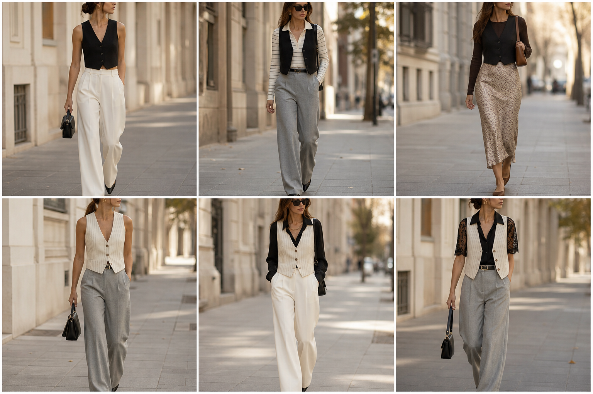

# Coletes preto curto e creme — street style

Peças âncora: **COL-02** e **COL-03**, com as peças dela. Gerada pela API (regerada com o colete creme risca de giz correto).
Prompt: [prompt](../../prompts/2026-11-07-coletes-preto-e-creme-street-style.md).

| # | Look | Combinação | ⭐ |
|---|---|---|---|
| 1 | Colete preto sozinho | COL-02, CAL-03, Bolsa preta pequena | |
| 2 | Colete preto e polo | COL-02, BLU-11, CAL-04, Cinto preto fino | |
| 3 | Colete preto e tricô | COL-02, BLU-15, SAI-02, Bolsa caramelo | |
| 4 | Colete creme sozinho | COL-03, CAL-04, Bolsa preta estruturada | |
| 5 | Colete creme e acetinada | COL-03, CAM-05, CAL-03, Colar dourado | |
| 6 | Colete creme e renda | COL-03, BLU-13, CAL-04 | |
