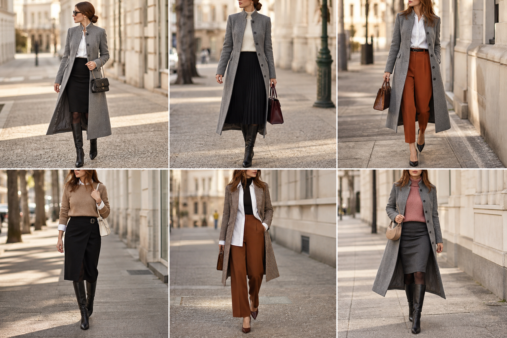

# Compras novas: casaco cinza, bota cano alto e camisa listrada (Zara)

Peças: **CAS-09**, **SAP-11**, **CAM-11**. Gerada pela API.

| # | Look | Combinação |
|---|---|---|
| 1 | Casaco cinza, camisa e lápis | CAS-09, CAM-11, SAI-05, SAP-11, BOL-06, Meia-calça fina preta |
| 2 | Casaco cinza e plissada | CAS-09, SUE-03, SAI-10, SAP-11, BOL-01, Meia-calça fina preta |
| 3 | Casaco cinza, camisa e terracota | CAS-09, CAM-11, CAL-13, BOL-02, Sapato preto de salto bloco |
| 4 | Camisa listrada sob camelo | CAM-11, SUE-12, SAI-08, SAP-11, BOL-05, Meia-calça fina preta |
| 5 | Camisa listrada e pied-de-poule | CAM-11, BLU-33, CAL-17, BLA-06, SAP-02, BOL-02 |
| 6 | Casaco cinza, rosa e lápis cinza | CAS-09, SUE-11, SAI-06, SAP-11, BOL-08, Meia-calça fina preta |
