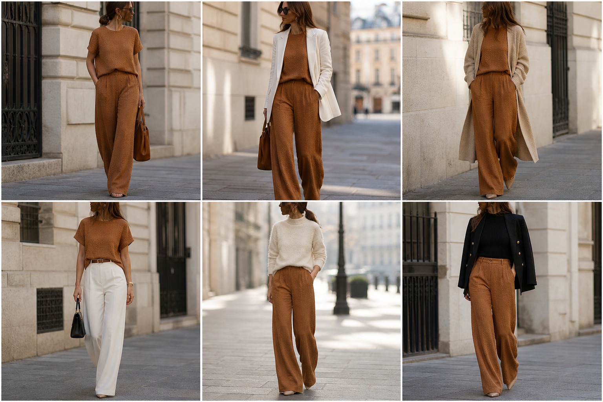

# Conjunto texturizado caramelo (blusa + pantalona) — street style

Peças âncora: **BLU-38** + **CAL-06**, com as peças dela. Gerada pela API.

| # | Look | Combinação | ⭐ |
|---|---|---|---|
| 1 | Conjunto caramelo | BLU-38, CAL-06, ACE-03, Bolsa caramelo | |
| 2 | Conjunto e blazer creme | BLU-38, CAL-06, BLA-08 | |
| 3 | Conjunto e casaco bege | BLU-38, CAL-06, CAS-03 | |
| 4 | Blusa caramelo e off-white | BLU-38, CAL-03, ACE-01, Bolsa preta pequena | |
| 5 | Pantalona e suéter creme | CAL-06, SUE-03 | |
| 6 | Pantalona e regata preta | CAL-06, BLU-33, BLA-05 | |
