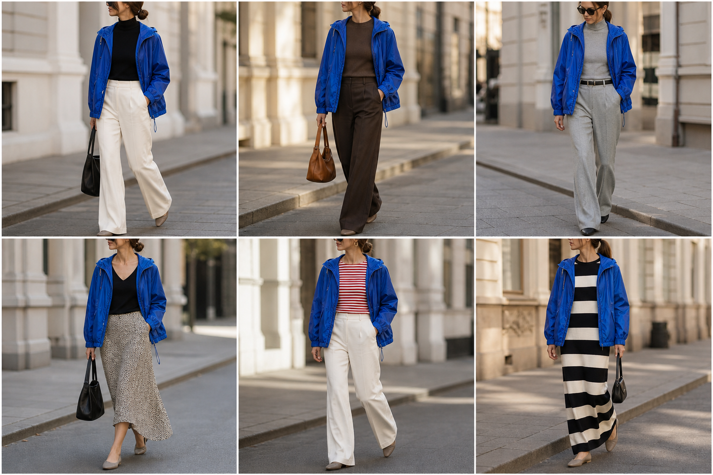

# Corta-vento azul royal (Amaro) — street style

Peça âncora: **JAQ-10**, com as peças dela. Gerada pela API.

| # | Look | Combinação | ⭐ |
|---|---|---|---|
| 1 | Corta-vento e off-white | BLU-23, CAL-03, Bolsa preta | |
| 2 | Corta-vento e marrom | BLU-15, CAL-05, Bolsa caramelo | |
| 3 | Corta-vento e cinza | BLU-18, CAL-04, ACE-02 | |
| 4 | Corta-vento e slip | BLU-22, SAI-02, Bolsa preta | |
| 5 | Corta-vento e listrada | BLU-10, CAL-03, ACE-03 | |
| 6 | Corta-vento e vestido listrado | VES-05, Bolsa preta pequena | |
