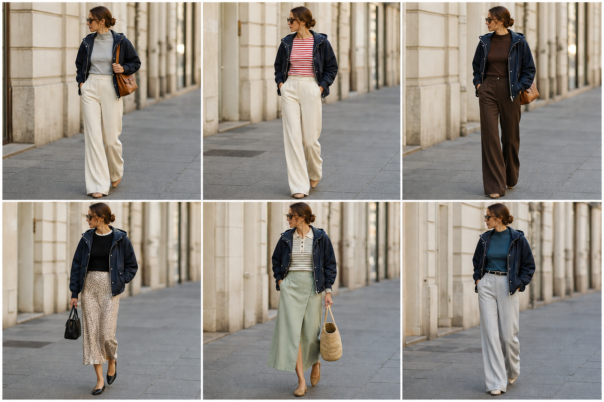

# Corta-vento marinho (Le Lis Blanc) — street style

Peça âncora: **JAQ-11**, com as peças dela. Gerada pela API.

| # | Look | Combinação | ⭐ |
|---|---|---|---|
| 1 | Marinho e off-white | BLU-18, CAL-03, Bolsa caramelo | |
| 2 | Marinho e listrada | BLU-10, CAL-03, ACE-03 | |
| 3 | Marinho e marrom | BLU-15, CAL-05, Bolsa caramelo | |
| 4 | Marinho e slip | BLU-17, SAI-02, Bolsa preta | |
| 5 | Marinho e saia verde | BLU-11, SAI-03, Bolsa de palha | |
| 6 | Marinho e cinza | BLU-19, CAL-04, ACE-02 | |
