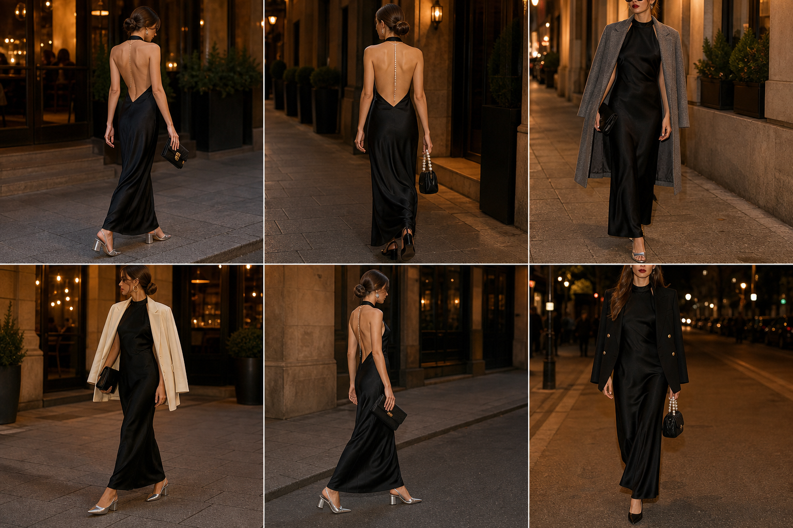

# ✨ Ocasião especial: jantar com vestido longo de cetim preto (Zara)

Peça: **VES-06**. Gerada pela API.

| # | Look | Combinação |
|---|---|---|
| 1 | Colar de costas dourado | SAP-10, BOL-09, Colar de costas dourado, Argolas douradas, Coque baixo polido |
| 2 | Pérolas nas costas | SAP-05, BOL-06, Colar de pérolas nas costas, Brincos de pérola, Coque baixo polido |
| 3 | Casaco cinza nos ombros | CAS-09, SAP-10, BOL-09, Brincos dourados longos, Boca vermelha |
| 4 | Blazer creme nos ombros | BLA-08, SAP-10, BOL-09, Argolas douradas grandes, Coque baixo polido |
| 5 | Prata minimalista | SAP-10, BOL-09, Corrente prata nas costas, Brincos prata |
| 6 | Blazer preto clássico | BLA-05, SAP-05, BOL-06, Brincos dourados, Boca vinho, Cabelo solto liso |
