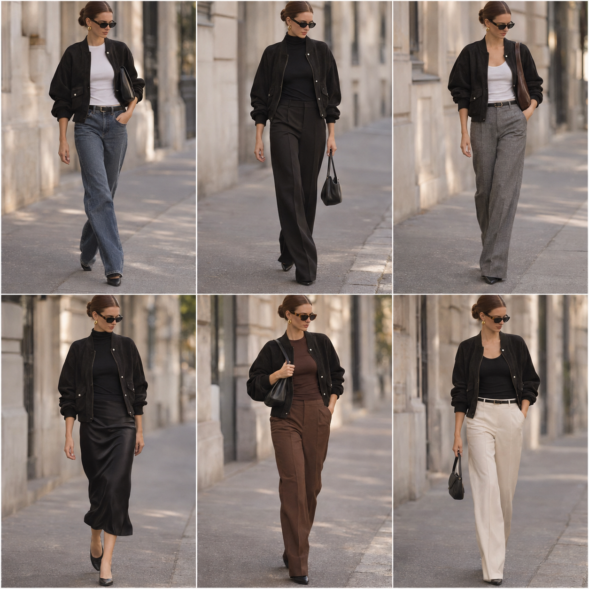

# Jaqueta bomber preta — street style

Peça âncora: **JAQ-02** (jaqueta bomber curta preta, oversized).
Prompt: [jaqueta bomber street style v3](../../prompts/2026-11-07-jaqueta-bomber-preta-street-style-v3.md).
Primeira imagem que ficou do jeito que ela queria ✨

| # | Look | Combinação (além da jaqueta) | ⭐ |
|---|---|---|---|
| 1 | Jeans e baby tee | Baby tee branca + jeans reto azul médio + cinto preto + bolsa baguete preta | |
| 2 | Total black | Gola alta preta fina + calça de alfaiataria preta longa + bolsa preta pequena | |
| 3 | Cinza mescla | Regata canelada branca + calça de alfaiataria cinza mescla + cinto preto + bolsa marrom | |
| 4 | Slip skirt | Gola alta preta fina + saia midi de cetim preta | |
| 5 | Preto e chocolate | Baby tee chocolate + calça de alfaiataria chocolate + bolsa preta | |
| 6 | Off-white | Regata canelada preta + calça de alfaiataria off-white + cinto preto + bolsa preta | |

Em todos: coque baixo liso, óculos escuros, argolas douradas.

As partes de baixo, as blusas básicas e as bolsas ainda **não estão no acervo**. Se você tiver
alguma delas, me diga que eu cadastro. As que faltarem viram lista de compras.
