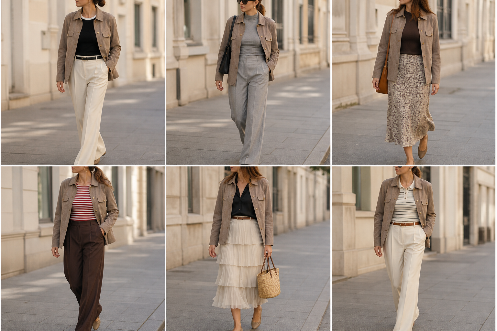

# Jaqueta-camisa de camurça caramelo — street style

Peça âncora: **JAQ-03**, com as peças dela. Gerada pela API (regerada com a cor certa: caramelo frio, levemente acinzentado).
Prompt: [prompt](../../prompts/2026-11-08-jaqueta-camurca-caramelo-street-style.md).

| # | Look | Combinação | ⭐ |
|---|---|---|---|
| 1 | Camurça, debrum e off-white | BLU-17, CAL-03, ACE-02 | |
| 2 | Camurça e gola alta cinza | BLU-18, CAL-04, Bolsa preta | |
| 3 | Camurça, tricô e slip | BLU-15, SAI-02, Bolsa caramelo | |
| 4 | Camurça, listrada e marrom | BLU-10, CAL-05, ACE-03 | |
| 5 | Camurça, acetinada e saia creme | CAM-05, SAI-01, ACE-01, Bolsa de palha | |
| 6 | Camurça, polo e off-white | BLU-11, CAL-03, ACE-01 | |

> **Removidos do app (jaqueta vai ser doada):** c92-05 c90-06 c89-06 c83-05 c72-02 c69-03 c61-06 c60-03 c54-06 c53-05 c49-06 c48-03 c35-04 c32-05 c24-06 c23-01 c22-06 c21-01 c21-02 c21-03 c21-04 c21-05 c21-06
