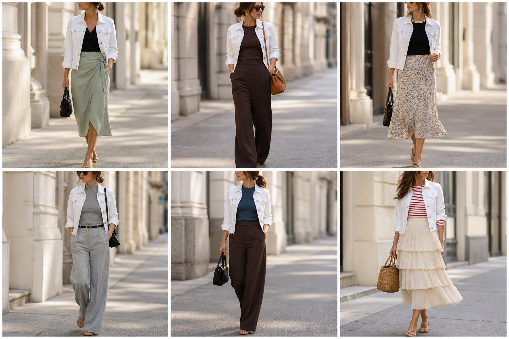

# Jaqueta jeans branca (Zara) — street style

Peça âncora: **JAQ-04**, com as peças dela. Gerada pela API.

| # | Look | Combinação | ⭐ |
|---|---|---|---|
| 1 | Jeans branca e saia verde | BLU-22, SAI-03, Bolsa preta pequena | |
| 2 | Jeans branca e marrom | BLU-15, CAL-05, Bolsa caramelo | |
| 3 | Jeans branca e slip | BLU-17, SAI-02, ACE-03, Bolsa preta | |
| 4 | Jeans branca e cinza | BLU-18, CAL-04, ACE-02 | |
| 5 | Jeans branca e azul petróleo | BLU-19, CAL-05, Bolsa preta | |
| 6 | Jeans branca e saia creme | BLU-10, SAI-01, Bolsa de palha | |
