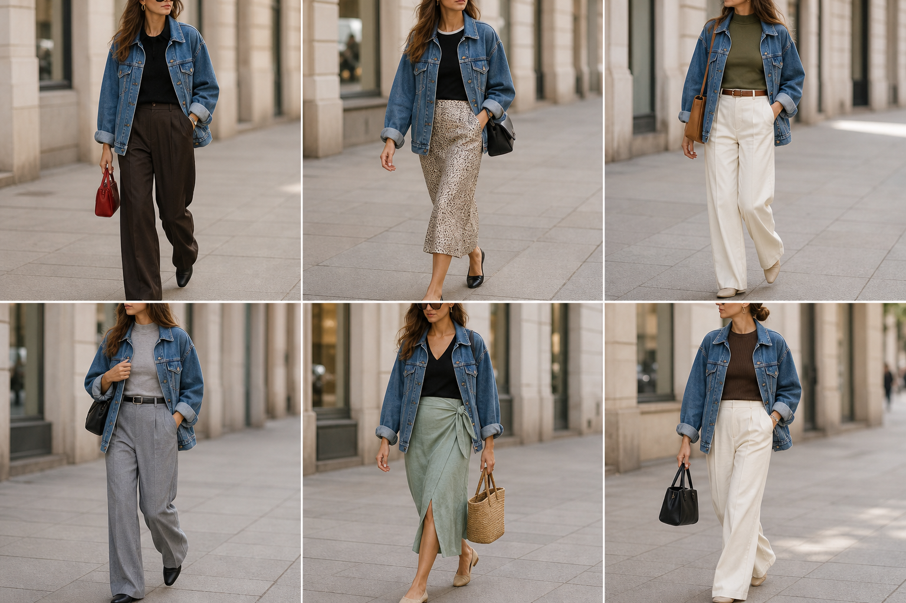

# Jaqueta jeans oversized azul — street style

Peça âncora: **JAQ-05**, com as peças dela. Gerada pela API.

| # | Look | Combinação | ⭐ |
|---|---|---|---|
| 1 | Jeans oversized e marrom | CAL-05, Blusa de tricô preta, Bolsa vermelha | |
| 2 | Jeans oversized e slip | BLU-17, SAI-02, Bolsa preta | |
| 3 | Jeans oversized e oliva | BLU-20, CAL-03, ACE-01, Bolsa caramelo | |
| 4 | Jeans oversized e cinza | BLU-18, CAL-04, ACE-02, Bolsa preta | |
| 5 | Jeans oversized e saia verde | BLU-22, SAI-03, Bolsa de palha | |
| 6 | Jeans oversized e tricô marrom | BLU-15, CAL-03, Bolsa preta | |
