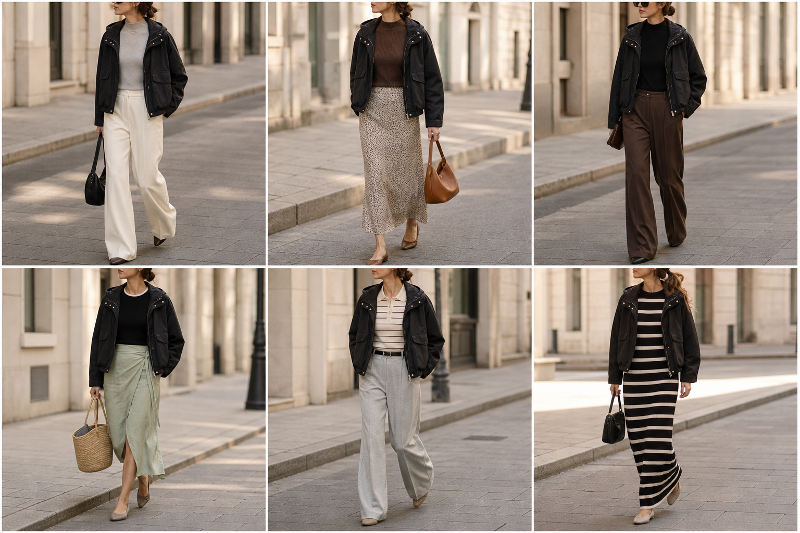

# Jaqueta utilitária preta — street style

Peça âncora: **JAQ-09**, com as peças dela. Gerada pela API.

| # | Look | Combinação | ⭐ |
|---|---|---|---|
| 1 | Utilitária e off-white | BLU-18, CAL-03, Bolsa preta | |
| 2 | Utilitária e slip | BLU-15, SAI-02, Bolsa caramelo | |
| 3 | Utilitária e marrom | BLU-23, CAL-05 | |
| 4 | Utilitária e saia verde | BLU-17, SAI-03, Bolsa de palha | |
| 5 | Utilitária e cinza | BLU-11, CAL-04, ACE-02 | |
| 6 | Utilitária e vestido listrado | VES-05, Bolsa preta pequena | |
