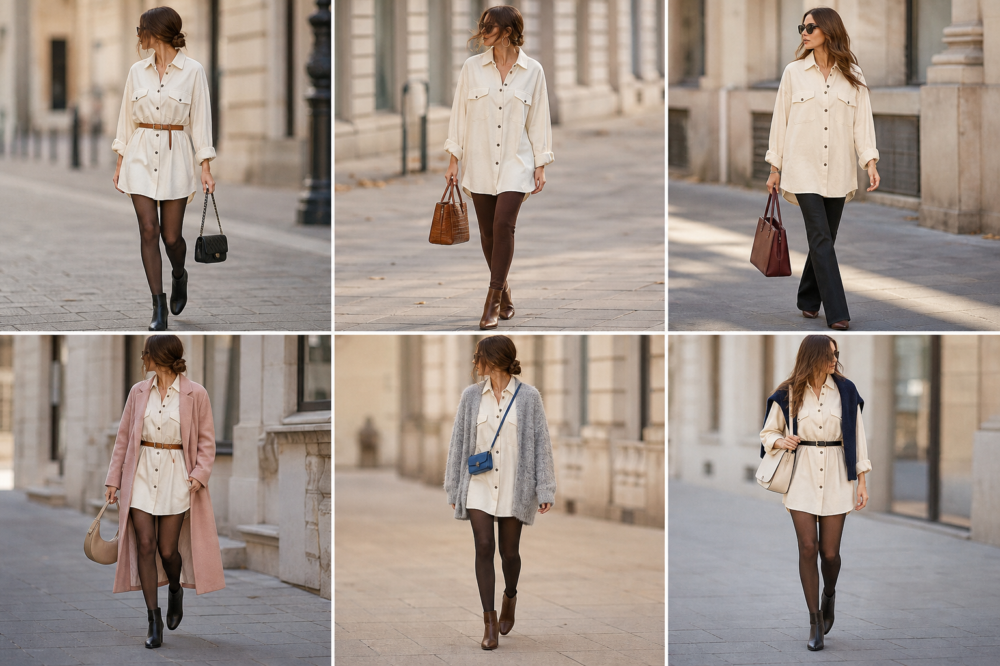

# Camisa Max Mara como vestido-camisa

Peça âncora: **CAM-06**, fechada como vestido/túnica. Gerada pela API.

| # | Look | Combinação |
|---|---|---|
| 1 | Max Mara vestido com cinto | ACE-01, BOL-06, Meia-calça preta opaca, Bota preta |
| 2 | Max Mara e legging marrom | CAL-19, BOL-02 |
| 3 | Max Mara túnica e flare | CAL-15, BOL-01 |
| 4 | Max Mara vestido e sobretudo rosa | CAS-07, ACE-01, BOL-08, Meia-calça fina preta |
| 5 | Max Mara vestido e tricô cinza | CAS-08, BOL-03, Meia-calça preta opaca, Bota marrom |
| 6 | Max Mara vestido e suéter nos ombros | SUE-02, ACE-02, BOL-05, Meia-calça fina preta |
