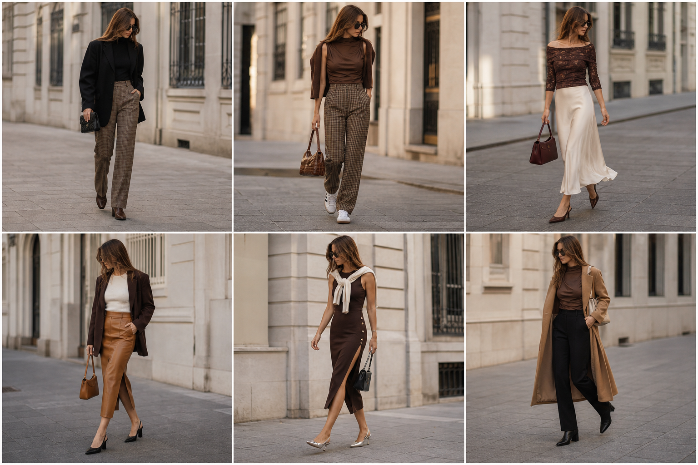

# Morina · trabalho

1. Xadrez + blazer preto: CAL-20, SAP-06, BOL-06, Gola alta preta, Blazer preto oversized
2. Elsa + xadrez: BLU-39, CAL-20, SAP-09, BOL-02, Cardigã café nos ombros
3. Renda + cetim: BLU-40, SAI-11, SAP-02, BOL-01
4. Laila + lápis caramelo: BLU-41, SAP-05, BOL-02, Saia lápis caramelo, Blazer chocolate
5. Clarice + suéter nos ombros: VES-07, SAP-10, BOL-06, Suéter creme nos ombros
6. Elsa + casaco camelo: BLU-39, SAP-07, BOL-05, Calça preta reta, Casaco camelo

Removidos a pedido (ela não tem a saia): 4. Laila + lápis caramelo (m3-04)
