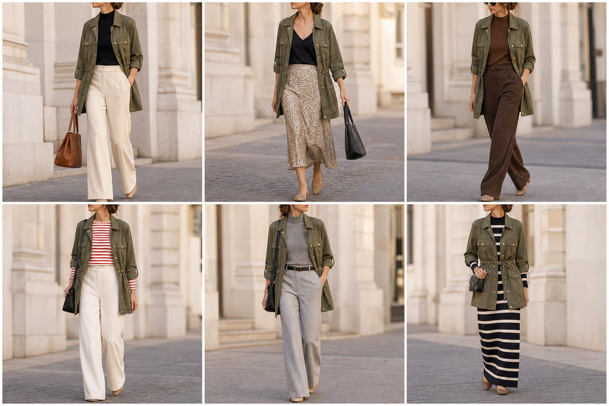

# Parka leve verde-oliva (Zara) — street style

Peça âncora: **CAS-05**, com as peças dela. Gerada pela API.

| # | Look | Combinação | ⭐ |
|---|---|---|---|
| 1 | Parka oliva e off-white | BLU-23, CAL-03, Bolsa caramelo | |
| 2 | Parka oliva e slip | BLU-22, SAI-02, ACE-03, Bolsa preta | |
| 3 | Parka oliva e marrom | BLU-15, CAL-05 | |
| 4 | Parka oliva e listrada | BLU-10, CAL-03, Bolsa preta | |
| 5 | Parka oliva e cinza | BLU-18, CAL-04, ACE-02 | |
| 6 | Parka oliva e vestido listrado | VES-05, Bolsa preta pequena | |
