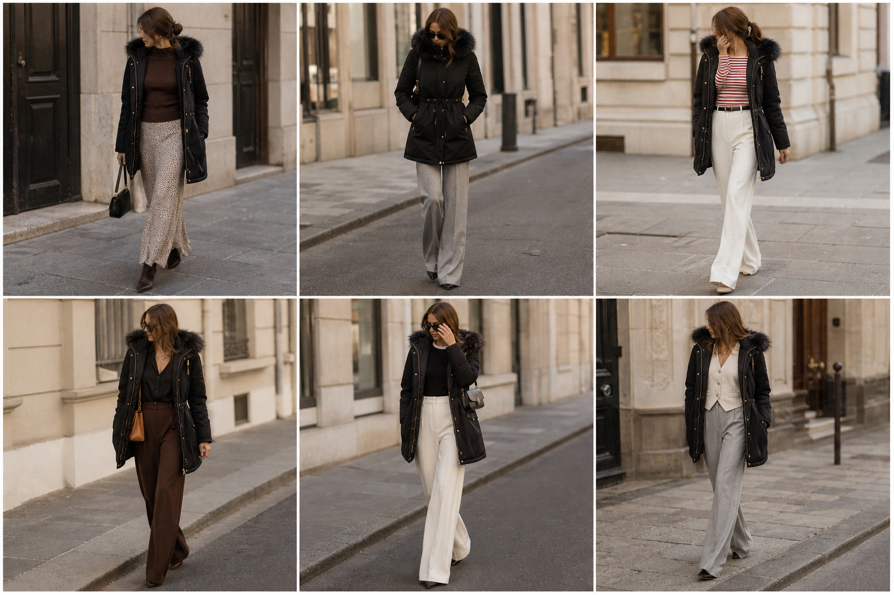

# Parka preta com capuz de pelo (Amaro) — street style

Peça âncora: **CAS-02**, com as peças dela. Gerada pela API.
Prompt: [prompt](../../prompts/2026-11-08-parka-preta-street-style.md).

| # | Look | Combinação | ⭐ |
|---|---|---|---|
| 1 | Parka, slip e tricô | SAI-02, BLU-15, Bolsa preta pequena | |
| 2 | Parka cinturada e cinza | CAL-04, Bolsa preta | |
| 3 | Parka, listrada e off-white | BLU-10, CAL-03, ACE-02 | |
| 4 | Parka, acetinada e marrom | CAM-05, CAL-05, Colar dourado, Bolsa caramelo | |
| 5 | Parka, debrum e off-white | BLU-17, CAL-03, Bolsa preta | |
| 6 | Parka, colete creme e cinza | COL-03, CAL-04, ACE-03 | |
