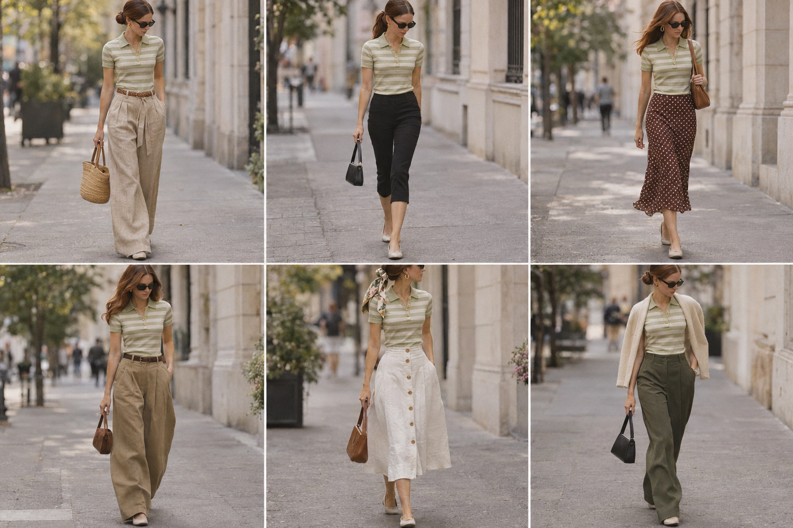

# Polo de tricô Erica Candy — street style

Peça âncora: **BLU-11** (polo de tricô listrada verde pistache, Brooksfield Donna). Só ela é do acervo.
Prompt: [polo street style](../../prompts/2026-11-07-polo-tricot-pistache-street-style.md).
O cabelo saiu castanho acobreado, como pedido.

| # | Look | Combinação (além da polo) | ⭐ |
|---|---|---|---|
| 1 | Linho | Pantalona de linho areia com amarração + cinto trançado caramelo + bolsa de palha | |
| 2 | Capri | Calça capri preta + bolsa preta pequena | |
| 3 | Poá | Saia midi de seda marrom com poá off-white + bolsa caramelo | |
| 4 | Calça balão | Calça balão de sarja cáqui + cinto marrom + mini bolsa de camurça | |
| 5 | Saia de linho | Saia midi de linho branca com botões + lenço no cabelo + bolsa caramelo | |
| 6 | Verde sobre verde | Calça de alfaiataria verde-oliva + cardigã off-white nos ombros + bolsa preta | |
