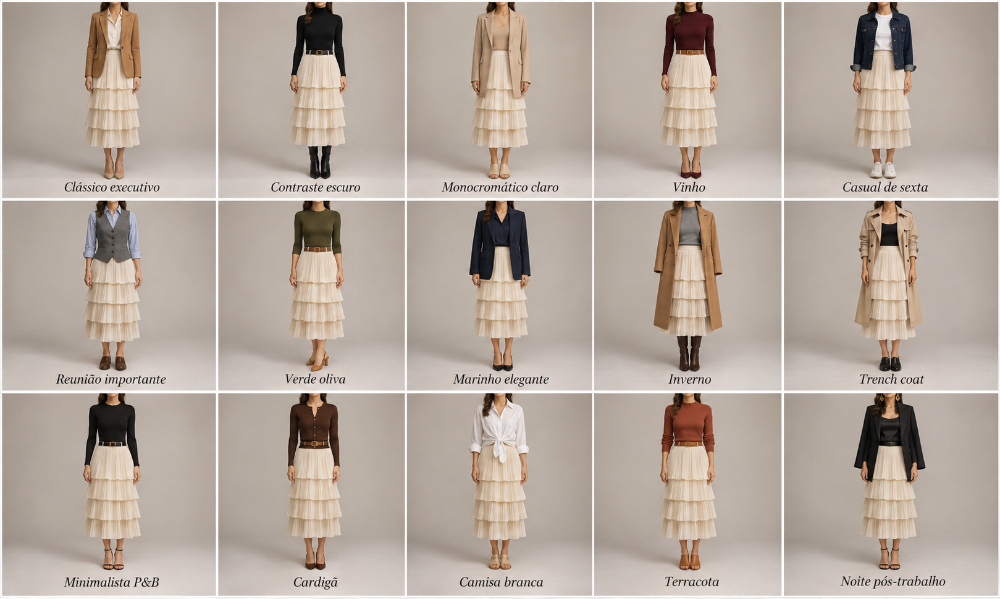

# Saia creme em camadas — 15 looks

Peça âncora: **SAI-01** (saia midi creme com babados plissados em camadas).

| # | Look | Combinação | ⭐ |
|---|---|---|---|
| 1 | Clássico executivo | Blazer caramelo + camisa off-white + scarpin nude | |
| 2 | Contraste escuro | Gola alta preta + cinto preto + bota preta | |
| 3 | Monocromático claro | Blazer longo bege + blusa nude + mule bege | |
| 4 | Vinho | Gola alta vinho + cinto caramelo + scarpin vinho | |
| 5 | Casual de sexta | Jaqueta jeans + camiseta branca + tênis branco | |
| 6 | Reunião importante | Colete cinza + camisa azul claro + mocassim marrom | |
| 7 | Verde oliva | Blusa verde oliva + cinto caramelo + scarpin caramelo | |
| 8 | Marinho elegante | Blazer marinho + blusa marinho + scarpin preto | |
| 9 | Inverno | Casaco camelo + malha cinza + bota marrom | |
| 10 | Trench coat | Trench bege + regata preta + mocassim preto | |
| 11 | Minimalista P&B | Blusa preta + cinto preto + sandália preta | |
| 12 | Cardigã | Cardigã marrom + cinto caramelo + scarpin marrom | |
| 13 | Camisa branca | Camisa branca com nó na cintura + sandália nude | |
| 14 | Terracota | Tricô terracota + cinto caramelo + mule caramelo | |
| 15 | Noite pós-trabalho | Blazer preto + regata de cetim preta + sandália preta + argolas | |

Marque ⭐ nos que você já usou e gostou — assim os próximos prompts seguem o seu gosto.
