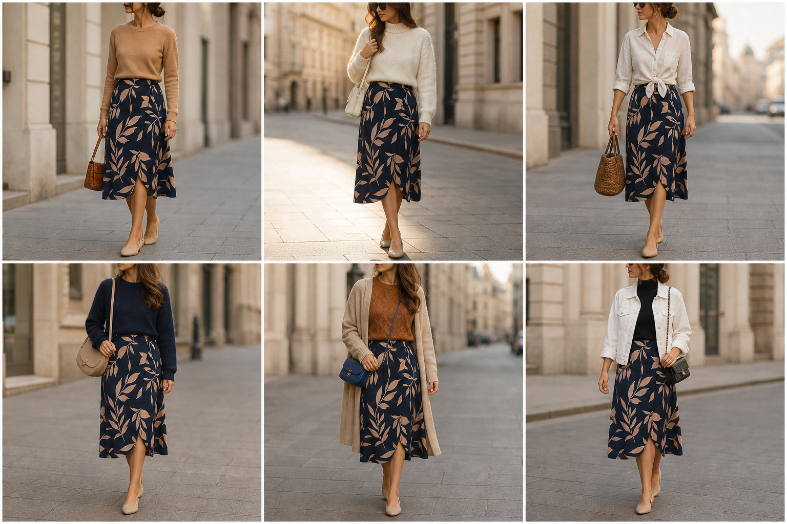

# Saia envelope marinho estampada — street style

Peça âncora: **SAI-07**, com as peças e bolsas dela. Gerada pela API. Obs.: a estampa saiu como folhinhas separadas; a real tem traços orgânicos maiores e entrelaçados.

| # | Look | Combinação | ⭐ |
|---|---|---|---|
| 1 | Envelope e camelo | SUE-12, BOL-02 | |
| 2 | Envelope e suéter creme | SUE-03, BOL-05 | |
| 3 | Envelope e camisa com nó | CAM-10, BOL-07, ACE-03 | |
| 4 | Envelope tom sobre tom | SUE-02, BOL-08 | |
| 5 | Envelope e casaco bege | BLU-38, CAS-03, BOL-03 | |
| 6 | Envelope e jaqueta branca | BLU-33, JAQ-04, BOL-06 | |
