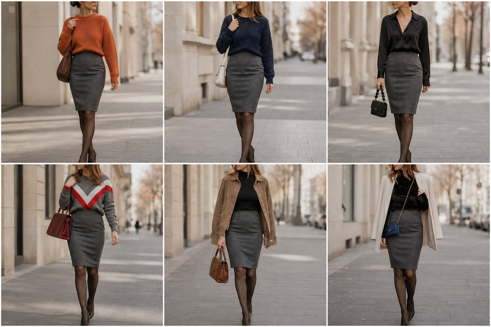

# Saia lápis cinza chumbo — street style

Peça âncora: **SAI-06**, com as peças e bolsas dela. Gerada pela API.

| # | Look | Combinação | ⭐ |
|---|---|---|---|
| 1 | Lápis cinza e laranja | SUE-06, BOL-07, Meia-calça fina preta | |
| 2 | Lápis cinza e marinho | SUE-02, BOL-05, Meia-calça fina preta | |
| 3 | Lápis cinza e camisa preta | CAM-05, BOL-06, ACE-03, Meia-calça fina preta | |
| 4 | Lápis cinza e chevron | SUE-04, BOL-01, Meia-calça fina preta | |
| 5 | Lápis cinza e camurça | BLU-33, JAQ-03, BOL-02, Meia-calça fina preta | |
| 6 | Lápis cinza e veludo | BLU-37, BLA-08, BOL-03, Meia-calça fina preta | |
