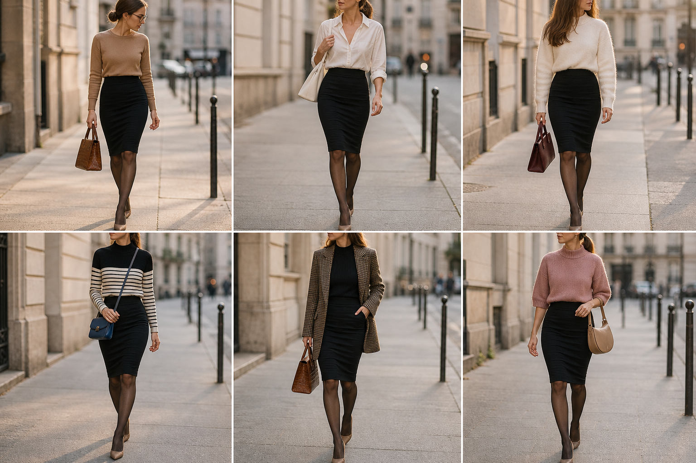

# Saia lápis preta de malha — street style

Peça âncora: **SAI-05**, com as peças e bolsas dela. Gerada pela API.

| # | Look | Combinação | ⭐ |
|---|---|---|---|
| 1 | Lápis e camelo | SUE-12, BOL-02, Meia-calça fina preta, Óculos de grau | |
| 2 | Lápis e camisa branca | CAM-10, BOL-05, Meia-calça fina preta | |
| 3 | Lápis e suéter creme | SUE-03, BOL-01, Meia-calça fina preta | |
| 4 | Lápis e listras | SUE-10, BOL-03, Meia-calça fina preta | |
| 5 | Lápis e pied-de-poule | BLU-33, BLA-06, BOL-02, Meia-calça fina preta | |
| 6 | Lápis e suéter rosa | SUE-11, BOL-08, Meia-calça fina preta | |
